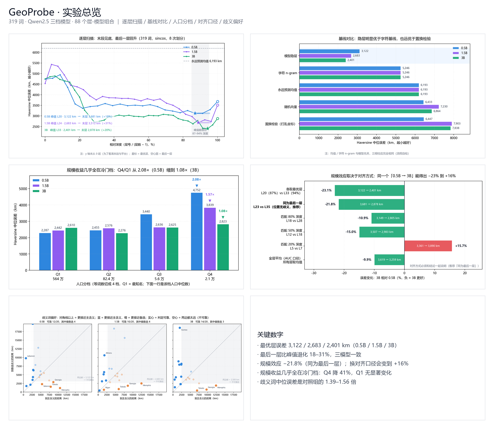
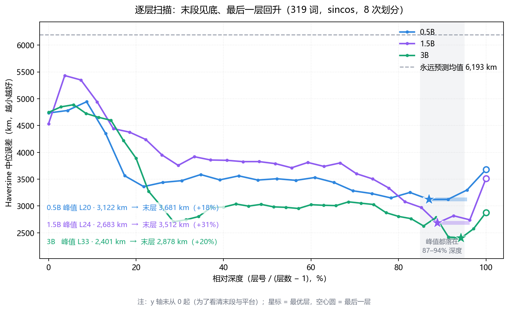
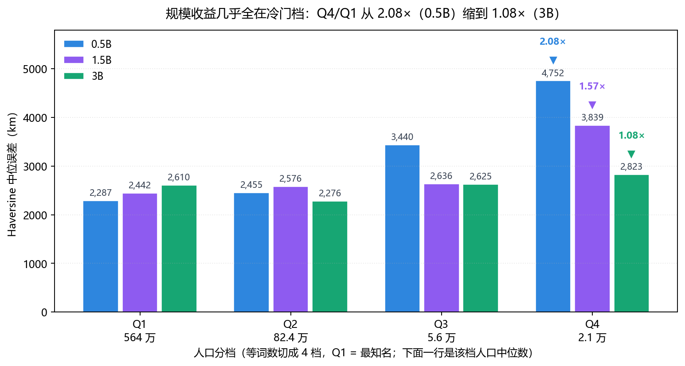
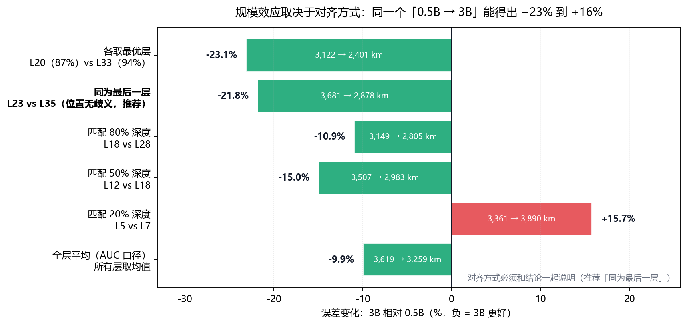
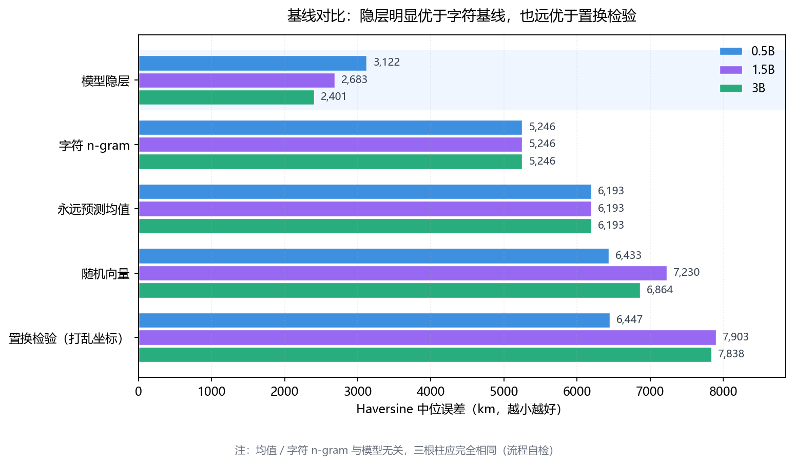
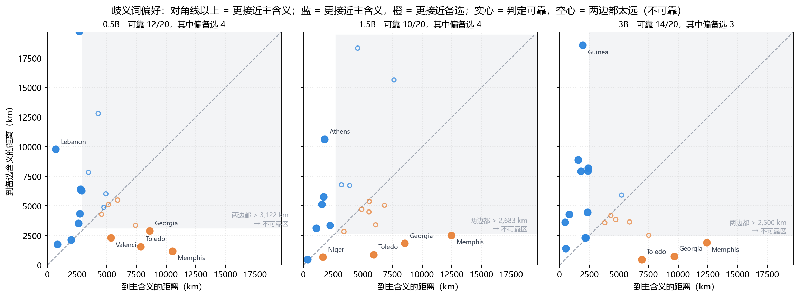

# GeoProbe

**LLM 地理知识探针：歧义地名的表征偏移分析**

一个可解释性（interpretability）小项目：检验 **LLM 的内部表征里是否编码了地理坐标**，
并进一步研究**当一个词有多重含义时，模型的地理表征会偏向哪一边**。

```bash
python -m geoprobe run --mock      # 无需模型/GPU/网络，30 秒看完整流程
python -m geoprobe run             # 用真实模型（默认 Qwen2.5-0.5B，CPU 可跑）
```

> **不需要 GPU。** 默认用 0.5B 模型 + 319 个词，CPU 上几分钟能跑完。
> 而且 `--mock` 模式让整个 pipeline 在**什么都没装**的情况下也能验证。



> 一图速览。下面各节有放大版，以及与之对应的数字。
> 所有图都由 `python scripts/plot_results.py` 从 `reports/*.json` 生成。

---

## 这个项目回答什么问题

课程/教程里的"RAG 效果展示"通常止步于"画了一张看起来像样的图"。
但一个**研究性**的问题需要能回答：

| 问题 | 本项目怎么回答 |
|---|---|
| 模型内部**有没有**地理知识？ | 线性探针：如果能从隐层线性解码出经纬度，说明信息**显式存在** |
| 这个"知识"有多准？ | **Haversine 公里误差**（不是 R²、不是"度的平方"） |
| 会不会只是**记住了拼写**？ | **字符 n-gram 基线** + **置换检验** |
| 歧义词会偏向哪个含义？ | **备选坐标**设计：Georgia 会落在高加索还是美国东南？ |
| 地理知识在**哪一层**形成？ | `layer-sweep` 逐层扫描 |

---

## 与"教学版探针"的七个关键差异

这个方向上的开源代码/课程实验普遍存在下面几个问题，本项目逐一修正：

### ① 指标：R² → Haversine 公里

原做法：`r2_score(y_test, y_pred)` + `mean_squared_error`。

**三个问题**：
- R² 对经纬度两维做 **uniform average**，把"经度可预测性"和"纬度可预测性"糊成一个数
- MSE 的单位是"**度的平方**"，没有物理意义 —— 12.5 平方度是好是差？
- 经纬度是**球面坐标**，同一"度"误差在赤道和北纬 60° 相差一倍

本项目主指标：**Haversine 大圆距离的中位数（km）**，并给 bootstrap 95% 置信区间。

> `R² = 0.85` 听起来不错，但平均误差可能是 3000 公里 ——
> 说明模型知道"在欧洲"，却分不清"巴黎"和"罗马"。**公里数能说清这一点。**

### ② 基线：从 0 个到 4 个

没有基线，R² 高就不能下结论。本项目内置：

| 基线 | 回答什么问题 |
|---|---|
| `mean` | 永远预测训练集坐标均值 → R²=0 的参照 |
| `random` | 随机向量 → 下界 |
| **`char_ngram`** | 字符 n-gram TF-IDF → **排除"模型只是记住拼写"** |
| **`permuted`** | **打乱训练集坐标**后再拟合 → 置换检验，判断探针是否真读到信息 |

> **`permuted` 是最关键的一条。** 纯噪声特征在"预测均值"基线下也可能碰巧通过
> （过拟合后个别点的预测会更接近真值，把中位数拉低），但**过不了置换检验**。
> 因此 `signal_ok` 的判据是"**R 次重复的中位误差均值 < 0.6 × 打乱坐标的中位误差**"，
> 而不是"优于均值基线"。**两边都取 R 次重复的均值** —— 拿"单次划分"去比"R 次均值"，
> 判定会被"哪次划分排在最后"这个随机因素翻转（这是实测踩过的坑）。

### ③ 切口：歧义地名

探针**只在无歧义地名上训练**（Paris、Tokyo、Brazil…），
再用**歧义地名**测试（Georgia、Turkey、Chile、Jordan…）。

因为探针没在歧义词上训练过，它的输出反映的是**模型自身**对该词的地理表征偏好 ——
没有被训练过程引导。这就是"探针"和"分类器"的区别。

**关键创新是备选坐标**：`Georgia` 的真值取国家格鲁吉亚，
同时记录美国佐治亚州的坐标。于是可以回答一个比"误差多大"更有意思的问题：

> **模型把这个词放在哪了？**

### ④ 池化：三种方式可切

| 池化 | 说明 |
|---|---|
| `last_token` | 最后一个 token（最常见但最脏：任务指令会污染） |
| `mean` | 全序列平均 |
| **`entity_token`**（默认） | **只取地名本身的 token 均值**（最干净） |

### ⑤ 目标编码：把经度当作循环量（★ 修复一个真实建模缺陷）

```bash
--target-encoding latlon   # 目标 = [lat, lon]，线性（默认，向后兼容）
--target-encoding sincos   # 目标 = [lat, sin λ, cos λ]，经度在单位圆上
```

**为什么需要 `sincos`** —— 经度是**循环量**：

```
经度 179° 与 -179° 在地理上只差 2°（相邻），
但在线性目标空间里相差 358°。
线性回归无法表达这种周期性 —— 于是跨日界线的地名必然误差巨大。
```

**这不是理论担忧，而是实测到的**（合成实验中，隐层为位置的循环平滑函数时）：

| 编码 | 全部点经度中位误差 | 跨日界线的点（\|lon\|>150°） |
|---|---|---|
| `latlon` | 38.3° | **127.7°** |
| `sincos` | **0.2°** | **0.2°** |

> **所以：如果只用 `latlon` 编码看到 "R²(经度) 很低"，不能下结论说"模型不编码经度"** ——
> 那可能是编码方式的错。要判断这件事，必须用 `sincos` 跑一次。
>
> ⚠ **不能用 Mock 模式比较这两种编码**：Mock 的合成向量是「经度线性」构造的，
> 所以 `latlon` 天然更贴合它（实测 522 km vs 1353 km）。代码在 Mock 模式下会自动给出警告。

### ⑥ 偏向判定：加可靠性门槛（★ 避免一个解读陷阱）

比较"预测点离主含义近还是备选含义近"时，**如果两个候选都在几千公里外，这个比较毫无意义**。

实测数据里就有这种陷阱：

| 词 | 到主含义 | 到备选 | 差值 | 真相 |
|---|---|---|---|---|
| Santiago | 6,687 km | 6,675 km | **12 km** | 两边都没定位准 |
| Panama | 7,416 km | 7,276 km | 140 km | 同上 |
| Valencia | 4,386 km | **2,990 km** | 1,396 km | 较可信 |

所以 `alt_preference_analysis` 加了 `reliable` 标记：
**只有当「最近候选」≤ `alt_reliability_km`（默认 2500 km）时，才认定这个"偏向"可靠。**
报告与结论只统计可靠的条目，并明确写出被排除了几条。

### ⑦ 池化区间：用真实 tokenizer 验证，而不是"假设有 BOS"（★ 修掉一个颠覆结论的 bug）

`entity_token` 池化的"实体区间"曾经按「token 位置 0 是 BOS」实现，返回 `(1, n-1)`。
但 **Qwen2.5 的 tokenizer 不加 BOS**，于是这个区间实际变成「丢掉第一个 subtoken、
再丢掉最后一个」：

| 词 | token 序列 | 旧实现取到 | 现在取到 |
|---|---|---|---|
| `Tokyo` | `Tok` `yo` | **`yo`** | 两个都取 |
| `Ho Chi Minh City` | `Ho` ` Chi` ` Minh` ` City` | **` Chi` ` Minh`** | 4 个都取 |
| `Ulaanbaatar` | `U` `la` `an` `ba` `atar` | **`la` `an` `ba`** | 5 个都取 |

319 个词里只有 **22 个是单 token**，**51% 的地名 token 被丢弃**。
更糟的是它**与名字长度相关**（长名字多是小地名），于是系统性地放大了"知名度效应"、
抹平了"规模效应"。

修复后：裸地名取**全部 token 的均值**；带指令时用 `offset_mapping` 按字符区间
反查 token 区间（旧实现里 `text.find("{}")` 恒为 −1，前缀其实一直没被排除）。
后果：规模效应从 −15% 变成 **−22%**，而"知名度压倒规模"的旧结论作废。

> 教训：一个默认值的正确性如果**依赖从未被验证的假设**（这里有 BOS），
> 就该写一条用真实 tokenizer 的断言。`tests/test_entity_span.py` 现在有 19 条。

---

## 快速开始

### 方式一：Mock 模式（推荐先跑这个）

不需要 torch / transformers / 模型权重 / 网络。合成向量里编码了真实坐标，
用来**验证整条 pipeline 是自洽的**。

```bash
python -m geoprobe info           # 环境自检
python -m geoprobe check          # 只校验词表
python -m geoprobe run --mock     # 跑完整实验 + 生成报告
```

Mock 下的预期结果（这是流程正确性的证据）：

```
control 中位误差 :    ~520 km
permuted 基线    :  ~5,000 km     ← 打乱坐标后误差升高约 10 倍
mean 基线        :  ~5,280 km
signal_ok        :  True
```

### 方式二：真实模型

```bash
pip install torch transformers     # 首次会下载约 1 GB 的 Qwen2.5-0.5B
python -m geoprobe run --repeats 5
```

**★ 推荐用 `sincos` 编码跑一次**（理由见下一节）：

```bash
python -m geoprobe run --repeats 5 --target-encoding sincos   # 经度循环编码
python -m geoprobe run --repeats 5 --target-encoding latlon   # 线性（旧行为，用于对比）
```

跑完用脚本把结果写进本文档的「实测结果」段：

```bash
python scripts/update_readme.py
```

CPU 上 319 个词约需几分钟。也可以用更大模型：

```bash
python -m geoprobe run --model-name Qwen/Qwen2.5-1.5B-Instruct
```

### 方式三：逐层扫描（找"地理知识在哪一层涌现"）

```bash
python -m geoprobe layer-sweep              # 扫全部 24 层
python -m geoprobe layer-sweep --step 2     # 只扫偶数层，耗时减半
```

输出每层的误差与 R²，画成折线就能看到**涌现层**（浅层接近基线，某一层后急剧下降）。
跑完会打印**最佳层**，并把详细结果存到 `reports/layer_sweep.<模型>.<编码>.json`
（文件名带模型与编码，换模型/换编码重跑不会互相覆盖）。

> **实现要点（曾经的真实 bug）**：`extract_dataset()` 默认**只提取最后一层**。
> 早期版本在逐层循环里对每层各调用一次 `run_experiment()`，
> 而每次都重新提取（且只提最后一层），于是请求第 0 层时报
> `KeyError: 层 0 不在结果里（已提取 [23]）`。
>
> 正确做法是**一次性提取全部层，再在循环里复用** ——
> 这也把 24 次重复提取降到 1 次（提速约 24 倍）。
> 现在会把提取结果缓存到 `reports/activations.<模型>.<组>.npz`，
> 之后的调参（选层、换编码、换种子）都不必再跑模型。

---

## 实测结果

### 跨模型逐层扫描（319 词，0.5B / 1.5B / 3B）

| 模型 | 层数 | 最优层 | 最优层误差 | 最后一层 | 末层/最优 |
|---|---|---|---|---|---|
| Qwen2.5-0.5B | 24 | layer 20（87% 深度） | 3,122 km | 3,681 km | 1.18× |
| Qwen2.5-1.5B | 28 | layer 24（89% 深度） | 2,683 km | 3,512 km | 1.31× |
| Qwen2.5-3B | 36 | layer 33（94% 深度） | **2,401 km** | 2,878 km | 1.20× |

**三条稳健的形态**（三个模型一致）：

1. **浅层约 4,500–4,750 km** —— 比"永远预测均值"基线（6,193 km）好 25% 左右。
   所以**不能**说"前 20% 的层几乎没有地理信息"（早期版本这么写过，已撤回）
2. **可解码性在后段达到峰值**（87% / 89% / 94% 相对深度）
3. **最后一层比峰值退化 18–31%**，即"最后一层被挤压"是稳的



> 星标 = 各模型最优层（87% / 89% / 94% 相对深度）；空心圆 = 最后一层；
> 横段 = 层稳定性定义的平台（与最优值差 ≤ 1×层内噪声）；灰虚线 = 「永远预测均值」基线 6,193 km。
> 注意 y 轴未从 0 起，否则看不出末段的平台和回升。

> ⚠ **不要过度解读「最优层是第几层」**。
>
> 用「同层多组随机种子」量化噪声（4 组种子 × 5 次重复）后：层内噪声
> 148 / 182 / 109 km，层间差异 568 / 699 / 866 km，**信噪比 3.8× / 3.8× / 7.9×**
> —— 层排序是可分辨的，平台很窄（20–22 / 24–26 / 32–33，各 3 层）。
>
> 但**层数不同的模型之间比层号仍然有偏**（"挑最小值"在 36 层里比在 24 层里更容易
> 挑到运气好的那层）。所以要么报"相对深度"，要么直接比「同为最后一层」。
>
> 详见 [docs/稳定性与表征几何.md](docs/稳定性与表征几何.md)。

### ⭐ 规模效应明显，但优势几乎全在冷门地名上

参数从 0.5B 增到 3B（6 倍）让误差从 3,122 降到 2,401 km —— **同为最后一层时 −21.8%**，
各取最优层时 −23.1%。这个量级在几种对齐方式下都稳定（匹配到同一相对深度会小一些）。

但**这个改善几乎全部落在冷门地名上**。按人口把城市等词数切成 4 档（Q1 = 最知名）：

| 档 | 人口中位 | 0.5B | 1.5B | 3B | 配对中位差（0.5B−3B，正 = 3B 更好） |
|---|---|---|---|---|---|
| Q1 最知名 | 564 万 | **2,287 km** | 2,442 km | 2,610 km | +124 km（[−266, +596]，**不显著**） |
| Q2 | 82 万 | 2,455 km | 2,576 km | 2,276 km | +325 km（[−120, +616]，不显著） |
| Q3 | 5.6 万 | 3,440 km | 2,636 km | 2,625 km | +351 km（[+48, +941]，显著） |
| Q4 最不知名 | 2.1 万 | **4,752 km** | 3,839 km | **2,823 km** | **+1,540 km**（[+539, +2,188]，显著） |

读法：**Q4/Q1 的差距从 2.08×（0.5B）缩到 1.08×（3B）** —— 这不是因为大模型把著名地名
做得更好（Q1 基本没变，中位数上甚至略差），而是因为它**把最不知名那一档拉平了**
（4,752 → 2,823 km，−41%）。



> 柱顶数字是中位误差（km），三角标出各模型的 Q4/Q1 比值；横轴第二行是该档的人口中位数。

> Q1 那一格看着矛盾（中位数上 3B 更差 323 km，配对中位差却是 +124）：这是
> "中位数之差"和"配对中位差"这两种聚合方式在分布异质时会给出相反方向。
> 两个方向都**不显著**，所以正确说法是「Q1 上 0.5B 与 3B 无显著差异」。

> 所以「规模效应 vs 知名度效应谁更重要」这个问题**取决于模型大小**：
> 0.5B 上知名度效应 +108% 远大于规模效应；到 3B，知名度只剩 +8%，规模 −22% 反而主导。
> 早期版本曾写「规模效应远小于知名度效应」—— 那是**池化 bug 制造的假象**，见上面的 ⑦。



> **跨模型比较必须说明对齐方式。** 同一个「0.5B → 3B」，六种对齐能得出 −23% 到 +16%：
> 各取最优层 −23.1%、同为最后一层 −21.8%、匹配 80%/50% 深度 −10.9%/−15.0%、
> 匹配 20% 深度 **+15.7%（3B 反而更差）**、全层平均 −9.9%。推荐「同为最后一层」（位置无歧义）。

> 完整逐层数据（24+28+36 层 × 2 种编码）可复现：
> `python scripts/compare_encodings.py --repeats 8`

<!-- AUTO-RESULTS:START -->
<!-- 本段由 scripts/update_readme.py 从 reports/result.<模型>.<编码>.json 自动生成，请勿手改 -->

**实测环境**：`D:\models\Qwen2.5-3B-Instruct`　池化 `entity_token`　目标编码 `sincos`　层 `33`　重复划分 8 次

> 生成时间：2026-10-30 21:50　（运行 `python scripts/update_readme.py` 可重新生成本段）

### 主结果（Haversine 中位误差）

| 组 | n | 中位误差 | 均值 | P90 | 95% CI | 说明 |
|---|---|---|---|---|---|---|
| **A · 对照（留出集）** | 64 | **2,401 km** | 3,747 km | 8,944 km | [2,000 km, 3,334 km] | 探针能力上限（重复 std 182 km） |
| **B · 歧义地名** | 27 | **3,482 km** | 3,934 km | 7,142 km | [1,847 km, 4,837 km] | **1.45×** 于对照组 |

### 基线对比（A 组留出集）

| 特征来源 | 中位误差 | 相对隐层 | 意义 |
|---|---|---|---|
| 模型隐层（本项目主张） | 2,401 km | 1.0× | — |
| ★ 置换检验（打乱坐标） | 7,838 km | 3.3× | 判别探针是否真读到信息 |
| 字符 n-gram TF-IDF | 5,246 km | 2.2× | ★ 排除「只记住拼写」 |
| 随机向量 | 6,864 km | 2.9× | 下界 |
| 永远预测训练集均值 | 6,193 km | 2.6× | R²=0 的参照 |

### 关键发现

- **探针有效（中等）**：中位误差 2,401 km，比置换检验（打乱坐标，7,838 km）好 **3.3 倍**。
- **优于拼写基线**：字符 n-gram 基线为 5,246 km，隐层为 2,401 km（2.2 倍更准）—— 排除了「只是记住拼写规律」的解释。
- **两个方向都可解码** —— R²(纬度)=0.57，圆形 R²(经度)=0.70（n=512）。经度并没有比纬度更差，说明模型编码了**二维**的地理结构。
- **误差是长尾分布**：中位 2,401 km、均值 3,747 km（均值/中位 = 1.6），P90 = 8,944 km。说明大部分词能定到大致区域，但有少数被放到了地球另一端。（均值与 P90 取自单次划分，中位为多次重复平均。）
- **歧义效应 1.45×**：歧义词中位误差 3,482 km，对照组 2,401 km —— 歧义**显著**放大了误差。
- **含义偏好**：20 个带备选含义的歧义词中，**14 个**的最近候选落在 2,500 km 内（判定可靠），其中 **3 个**更接近备选含义（Georgia、Memphis、Toledo 等）。其余 6 个因两边都太远而被排除 —— 不加这个门槛会把噪声当成结论。

<!-- AUTO-RESULTS:END -->

### 基线对比（三模型）



> 隐层 2,401–3,122 km，字符 n-gram 5,246 km，置换检验 6,447–7,903 km。
> `mean` / `char_ngram` 两组的三根柱**完全等高** —— 这两条基线不使用模型，
> 所以三模型必须相同；对不上就说明词表、划分或编码没对齐（可当流程自检）。

### 歧义词偏向哪一边



> 20 个带备选坐标的歧义词：x = 到主含义，y = 到备选含义。
> **对角线以上 = 更接近主含义**（蓝），以下 = 更接近备选（橙）；
> **右上灰区 = 两个候选都超过可靠性门槛**（3,122 / 2,683 / 2,500 km），
> 这时"谁更近"只是噪声，不该解读。实心 = 判定可靠，空心 = 不可靠。
> 0.5B / 1.5B / 3B 的可靠条目分别是 12、10、14 条，其中偏备选的 4、4、3 条。

---

## 实验设计

```
A 组 control（319 个无歧义地名）
    │
    ├─ 随机划分 80/20，重复 N 次 → 均值 ± 标准差
    │
    ├─ 用 80% 训练 Ridge 探针（alpha 由训练集内部 K 折 CV 选）
    │
    ├─ 在 20% 留出集评估 ──────────→ 对照误差（探针能力上限）
    │
    ├─ 同一探针测 B 组（27 个歧义词）→ 歧义误差
    │     └─ 有备选坐标的 20 个 → 判断"更接近哪个含义"
    │
    └─ 测 C 组（24 个非地名）──────→ 负对照（无真值，只定性）

基线（都在 A 组留出集上）：
  mean / random / char_ngram / permuted
```

### 三组词表

| 组 | 数量 | 内容 | 用途 |
|---|---|---|---|
| `control` | **319** | 无歧义地名（280 城市 + 37 国家 + 2 地区） | **探针训练集** |
| `ambiguous` | 27 | 歧义地名（20 个带备选坐标） | **测试歧义效应** |
| `nongeo` | 24 | 非地名常用词 | **负对照** |

---

## 目录结构

```
GeoProbe/
├── geoprobe/
│   ├── config.py      配置（YAML + 环境变量覆盖 + mini-YAML 兜底）
│   ├── metrics.py     ★ Haversine、bootstrap CI、圆形 R²（经度专用）
│   ├── wordlists.py   三组词表与坐标校验
│   ├── extract.py     ★ 模型加载、层路径兼容、三种池化、内存预检、Mock 提取器
│   ├── targets.py     ★ 目标编码（经度 sin/cos 循环编码）
│   ├── probe.py       Ridge / MLP / Mean 探针
│   ├── baselines.py   ★ 字符 n-gram / 随机基线
│   ├── experiment.py  ★ 实验编排 + 置换检验 + 歧义偏好分析
│   ├── geometry.py    表征几何（残差范数、层间旋转、有效维度）
│   ├── lens.py        logit lens（含有效性检验；在 Qwen2.5 上中间层失效）
│   ├── report.py      自动生成 Markdown 报告（结论由数据推出）
│   └── cli.py         命令行（info/check/models/run/layer-sweep/geometry/logit-lens）
├── data/
│   ├── words_control.json          319 条 A 组（280 城市 + 37 国家 + 2 地区）
│   ├── words_ambiguous.json        B 组 27 条歧义地名（20 条带备选坐标）
│   ├── words_nongeo.json           C 组 24 条非地名（负对照）
│   ├── words_control.backup108.json  扩充前的 108 条（保留可追溯）
│   └── cities15000.zip             GeoNames 数据（不入库，见 data/README.md）
├── configs/default.yaml
├── scripts/
│   ├── expand_wordlist.py         ★ 从 GeoNames 扩充词表（含排除规则）
│   ├── audit_wordlist.py          词表自动质检
│   ├── compare_encodings.py       ★ 离线比较「编码 × 层 × 模型」
│   ├── check_layer_stability.py   层结论稳定性（层内噪声 vs 层间差异）
│   ├── stratified_analysis.py     按词类分层统计
│   ├── migrate_reports.py         按模型标识整理历史结果文件
│   ├── update_readme.py           把结果写进本文件的实测段落
│   ├── build_wordlist.py          用 Nominatim 刷新坐标
│   └── count_lines.py             规模统计
├── tests/             214 个测试
└── reports/           运行产物（已 gitignore）
```

---

## 三个技术坑（代码里都有注释）

### 坑 1：不同模型的"层"属性名不同

```python
Qwen1 / GPT-2:                    model.transformer.h[-1]
Qwen2 / 2.5 / 3 / Llama / Mistral: model.model.layers[-1]
BERT:                              model.encoder.layer[-1]
```

课程实验写死了第一种，**换成 Qwen2 直接 AttributeError**。
`extract.py::resolve_transformer_layers()` 按优先级探测，找不到时给出清晰的报错
（列出已尝试的路径），而不是让调用方在 `AttributeError` 里猜。

### 坑 2：钩子忘了移除会持续泄漏

```python
try:
    for idx in targets:
        handles.append(layers[idx].register_forward_hook(make_hook(idx)))
    with torch.no_grad():
        model(input_ids=input_ids)
finally:
    for handle in handles:      # ★ 必须移除
        handle.remove()
```

而且**一次注册所有层**（为了 layer sweep），不要每层单独跑一遍前向 —— 那样慢 N 倍。

### 坑 3：`activations[-1]` 不一定是"地名本身"

如果输入是 `"What are the geographic coordinates of Paris?"`，
最后 token 是**问号**。它 attend 过全序列，但编码重点偏"任务意图"而非"实体知识"。

所以默认用 `entity_token` 池化，并且**默认不加任务指令**
（`extract.use_instruction: false`）—— 只喂裸地名，避免"准备输出数字"的状态污染表征。

---

## 输出示例（结构）

`reports/report.md` 包含：

1. **配置**（模型 / 池化 / 层 / 探针）
2. **主结果表**：A 组 vs B 组的中位误差、均值、P90、95% CI
3. **基线对比表**：隐层 vs 字符 n-gram vs 随机 vs 置换 vs 均值
4. **歧义词含义偏好表**：每个词到主含义/备选含义的距离，以及"更接近哪个"
5. **错误分析**：B 组误差最大的 10 个词 + 真实/预测坐标
6. **结论**（**由数据自动推出**，不是写死的）
7. **已知局限**

> 结论部分会随结果变化：如果探针没通过置换检验，
> 报告会明确写出"⚠ 探针未通过置换检验，此时不应把 B 组解读为歧义效应"。

---

## 已知局限（诚实清单）

1. **只能检测线性可解码性。** Ridge 差而信息实际存在（非线性编码）时会被误判为"没有信息"。
   加 `--with-mlp` 做对照可部分排除。
2. **单层评估。** 用 `layer-sweep` 才能看到涌现层。
3. **词表里混了不同难度的地名。** 原 108 个是著名地点，扩充的 211 个是中小城市。
   实测（3B 平台层）两部分的误差比是 **1.16×**（0.5B 为 1.37×）——
   **报总误差时必须同时说明这个构成**，否则数字不可比。
4. **探针 ≠ 输出行为。** 探针测的是"表征中可解码的信息"，
   而模型输出时可能仍说"不知道"。**这个区别正是探针的价值所在**
   —— 它能把"知道"和"说得出"分开。
5. **坐标来自 GeoNames `cities15000`**（城市，精度 < 10 km）与人工填写的国家质心（约 ±100 km）。后者是**粗尺度目标**，与城市不可直接比较 —— 所以词表里标注了 `difficulty`（粗/精）与 `expected_radius_km`。
6. **规模效应与知名度效应的相对大小取决于模型尺寸。** 参数从 0.5B 增到 3B（6 倍）
   让误差降 22%（同为最后一层），且**收益几乎全在冷门地名上**：最知名四分位
   0.5B→3B 无显著变化，最不知名四分位降 41%。而在 0.5B 内部，"最不知名 vs 最知名"
   的差距是 +108% —— 所以小模型上知名度更重要，大模型上规模效应反超。
   **不要笼统说"规模没用"或"知名度更重要"，必须带上模型尺寸与对齐方式。**

---

## 复现命令

```bash
python -m geoprobe info                 # 环境自检
python -m geoprobe check                # 词表校验
python -m geoprobe run --mock           # 无模型跑通全流程
python -m geoprobe run                  # 真实模型
python -m geoprobe layer-sweep          # 逐层扫描
python -m pytest tests -q               # 214 个测试
```

---

## 许可

MIT。词表与坐标仅用于学术性分析方法演示。
